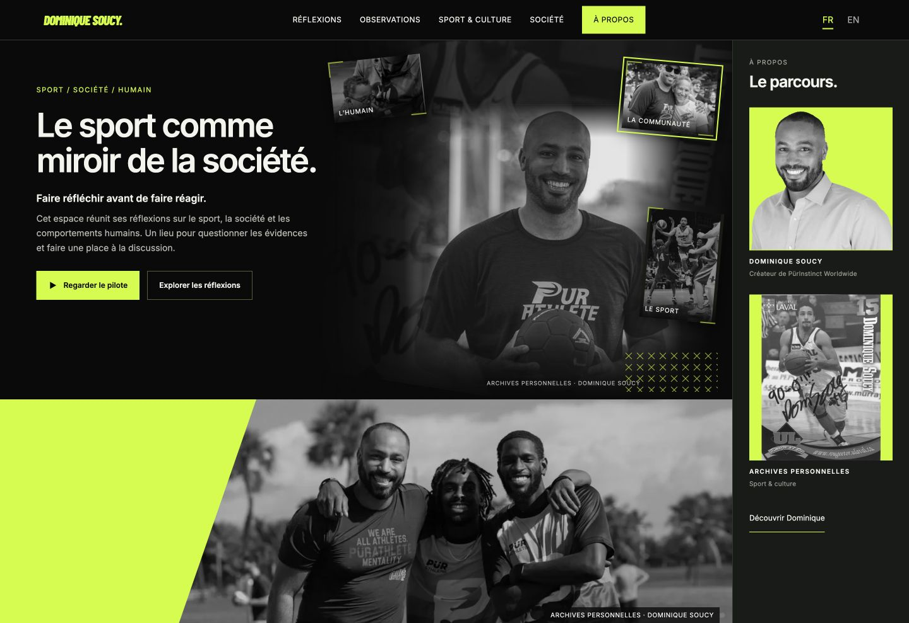
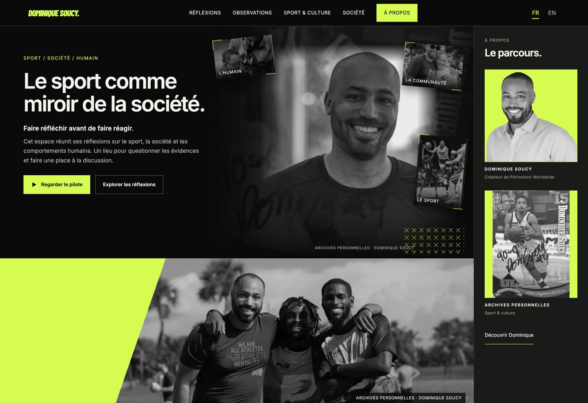
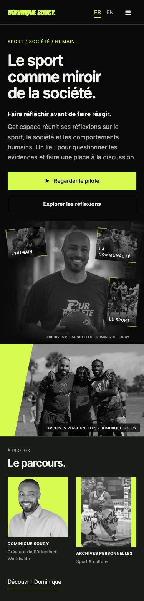
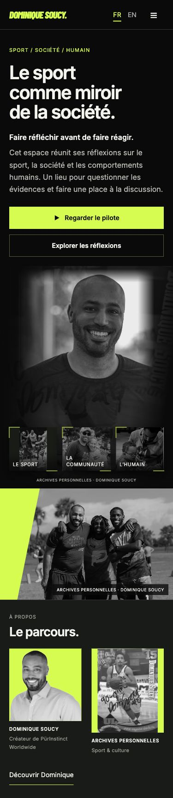

# V6.1 — Immersive portrait refinement

The attached V6.1 reference and brief are stored beside this document for design review only. Neither is served by the application. This is a focused refinement of V6; the navigation, copy, calls to action, biography sidebar, lower photography, editorial sections and consent-based pilot remain unchanged.

## Exact photograph and identity

Source: `public/assets/dominique/originals/05_portrait_ballon.jpg` (512 × 512 px), the authentic original already used in V6. The file is unchanged. Only CSS cropping, uniform scaling, grayscale, a slight contrast adjustment and the existing grain overlay are applied. No image generation, reconstruction, facial animation or photographic pixel edits are used. The provisional cutouts and AI-rendered reference faces are not rendered.

The visible source ends at y≈338, before the ball starts after y≈350; eyes, smile, beard and chin remain inside the crop. The source is clipped before scaling, so the ball cannot reappear through parallax. Soft masks remove hard frame edges. The three original satellite photos remain.

## Framing and resolution limit

Desktop now renders the full source at up to 720px wide, versus 440px in V6: an apparent face-size increase of approximately 64%. Configured crop scale is 1.65; a 720px full-image cap limits enlargement to approximately 1.41× the native 512px width. This is a deliberate ceiling: the supplied source cannot match the huge, crisp AI-rendered close-up in the reference without visible softness. It remains softer on high-density desktop displays than a new professional portrait would. No synthetic detail or sharpening is added to disguise that limitation.

Mobile has a separate crop and reserved composition height. Portrait framing uses 78% of the viewport with the same capped zoom. The satellite photographs form a separate, non-overlapping row beneath the face; they never cover the eyes, smile or headline. The portrait is static on mobile.

## Central configuration

`lib/hero-media.ts` contains the source path, intrinsic dimensions, localized alt text, optional monochrome treatment, maximum rendered image width, desktop object position/scale/excluded lower pixels/vertical offset, and a separate mobile crop. `heroPortraitStyle` exports these values as CSS variables. To use a future approved portrait, edit this configuration only, including the new dimensions and suitable crop values; no hero JSX needs rebuilding. An automated test verifies an alternative high-resolution configuration.

## Files and interactions

- `components/cinematic-collage.tsx`: consumes the centralized portrait configuration and localized alt text. The existing native toggle buttons and bounded pointer event architecture are retained.
- `app/homepage-v6.css`: enlarged close-up, source clipping, soft edge masks, dedicated mobile row, and separate satellite depths (−0.5, −0.8 and +0.35 versus portrait depth 1). Desktop hover/focus adds only a 3.5% satellite enlargement and 4px lift. The face is translated uniformly, never deformed.
- `tests/hero-media.test.ts`: ball-exclusion/face-retention regression and configuration replacement coverage.
- `vercel.json`: disables Git deployment for this review branch.

Reduced motion keeps the framing but disables movement and transitions. Existing listeners reset offsets when media preferences change and clean up pending frames. No new animation library is added.

## Verification

38 automated tests pass, including original-photo/package integrity and every existing adaptive-video orientation/layout test. Lint, TypeScript, content validation, production build, formatting and diff checks pass. FR and EN were inspected at 375, 430, 768, 1440 and 1920px: no horizontal overflow, no overlapping satellite frames, correct localized actions and intact sidebar. Screenshots were visually inspected at all five widths. Desktop pointer movement produces distinct restrained satellite offsets; Enter selection was verified. Compiled desktop/mobile screenshots are included below.

The host's reduced-motion setting was not changed; that branch was reviewed in the CSS and media-query logic rather than simulated through an unsupported browser emulation API. No other requested check is unavailable.

Review only. Branch: `codex/homepage-v6-1-immersive-portrait`. Do not merge or deploy without approval.

## Before / after

| V6                                              | V6.1                                    |
| ----------------------------------------------- | --------------------------------------- |
|  |  |
|    |    |
