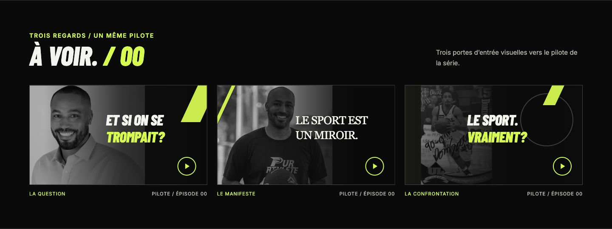
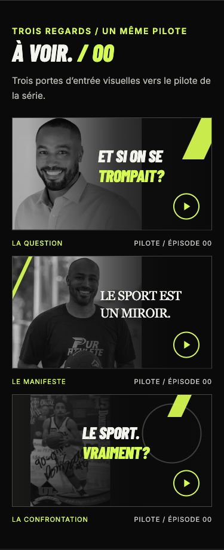
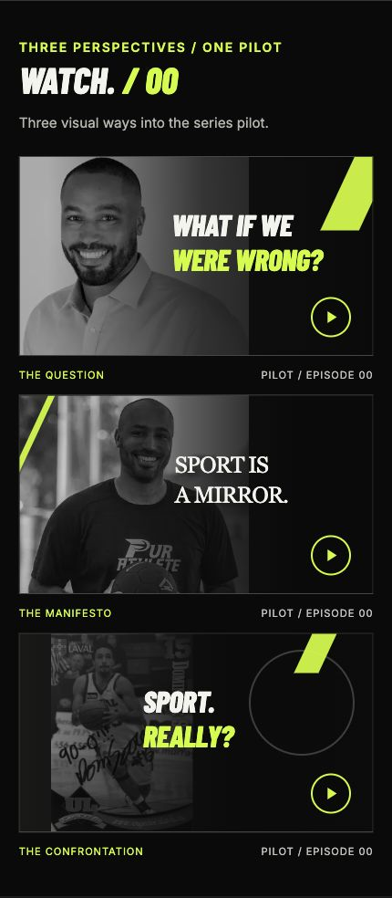
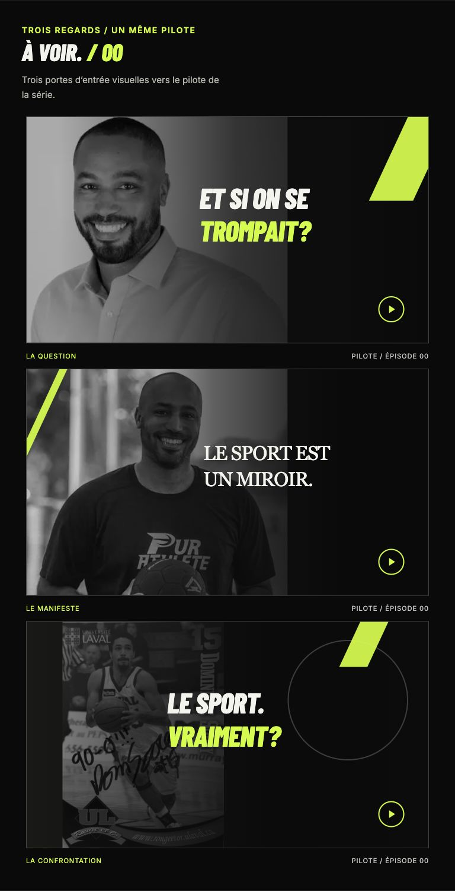
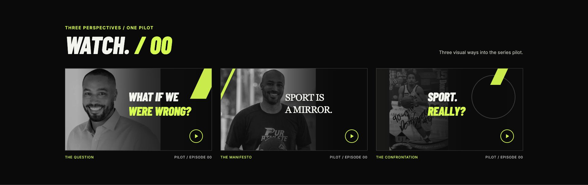

# V6.2 — Three editorial pilot thumbnails

Continue PR #7 on `codex/three-pilot-thumbnail-styles`. The branch's existing thumbnail implementation was retained and refined. `main` was merged into it first because it was based on V6 and lacked the approved V6.1 immersive portrait. No production merge or deployment is part of this update.

## Preserved and refined

The collection remains between `CinematicHero` and `PilotFeature`. The existing hero, its media configuration, collage, sidebar, photography and video components are unchanged from current main. All three cards stay 16:9 while the single pilot player remains portrait 9:16. Desktop shows three cards in one row; mobile/tablet up to 900px stacks them vertically.

The three existing directions remain recognizable:

- **The question**: authentic blue-shirt portrait (`02_portrait_chemise_bleue.jpg`), bold condensed italic title, monochrome image and lime emphasis.
- **The manifesto**: authentic ball portrait (`05_portrait_ballon.jpg`), restrained serif editorial typography, dark image and minimal lime rule.
- **The confrontation**: authentic signed Rouge et Or archive (`07_archive_rouge_et_or.jpg`), energetic typography and lime slash/court motif. The complete postcard is contained within its photographic layer to retain original signature, marks and face.

Images reserve a 16:9 frame and their own photographic layer, avoiding the previous oversized face crops. The source originals remain byte-identical. No photographic raster edits or generated faces are used. Each real anchor has a descriptive localized accessible name, a visible play control and style/episode identification. Decorative image alt text is empty because the anchor already describes the complete editorial action.

The supplied request contains written art directions and refers to three separate approved visual concepts, but no separate concept image files are present in the request or PR branch. Visual review therefore compares the existing PR implementation and those written directions; no claim of a pixel comparison against unavailable concept images is made.

## Configuration and future videos

`lib/pilot-thumbnails.ts` centralizes style, FR/EN title lines, image path/position/fit, video URL, localized episode label, optional subtitle and optional local published video page. `PilotThumbnailCollection` accepts an alternate entries array for reuse. Current entries all reference `pilotVideo.videoUrl` from `lib/config.ts`; the URL is not duplicated across components.

`thumbnailDestination` normalizes supported video providers before comparing with the pilot. All current cards resolve to `#pilote`, including alternate YouTube URL forms for the same video. A future different video resolves to its configured local FR/EN `watchPath` when available, otherwise its original supported media URL. It never incorrectly sends a different episode to the pilot. Use an existing published editorial watch page to play future videos within the site's unchanged `AdaptiveVideo` infrastructure. The three thumbnail styles impose no orientation on playback; portrait, landscape and square support remains covered by the existing tests.

`PilotThumbnailLink` preserves native anchors/no-JS navigation and modified clicks. Unmodified activation focuses the actual existing `#pilote` group, updates the fragment and scrolls it below the sticky header. Repeated activation works even when the hash is already `#pilote`. It never activates an iframe or starts audio. The player retains its separate user-initiated external-video control.

## Interaction and performance

Image hover zoom is 4%, with a lime frame, brighter image and more prominent play icon. Transitions run for 400ms. Keyboard focus gets the same visual treatment. Reduced motion removes transitions and zoom; focus, borders and contrast still communicate the action.

Images use Next Image, lazy loading and responsive sizes. Frame space is reserved before loading. No animation library, autoplay media, additional video player or third-party request was added to the collection. The question portrait's original resolution is 447px square; no synthetic detail is added, and extreme desktop/DPR magnification remains limited by the original source quality.

## Validation

- `npm run content:check`: passes, zero editorial entries as before.
- `npm test`: 41 passing tests, including original/photo package integrity, all adaptive-video orientations/layouts, three card configurations, safe future destinations and native anchor semantics.
- `npm run lint`, `npm run typecheck`, `npm run build`, formatting and diff checks: pass.
- Actual rendered screenshots reviewed at 375, 430, 768, 1440 and 1920px, in FR/EN across the review set. Automated DOM measurements cover both languages at every width: no horizontal overflow, three correctly proportioned cards, intact sidebar, one portrait player and no initial iframe.
- All three card destinations and repeated activation were checked against the existing player, including keyboard activation. The correct YouTube ID is `6Zy87nhpHS8`; user activation creates only the existing privacy-enhanced embed without an autoplay parameter.
- Reduced-motion rules were reviewed in CSS and link logic; the host OS preference was not changed.

The PR contains screenshots in `review/`. The preview URL is recorded in the PR description and Codex delivery; production remains unchanged.

## Review captures

