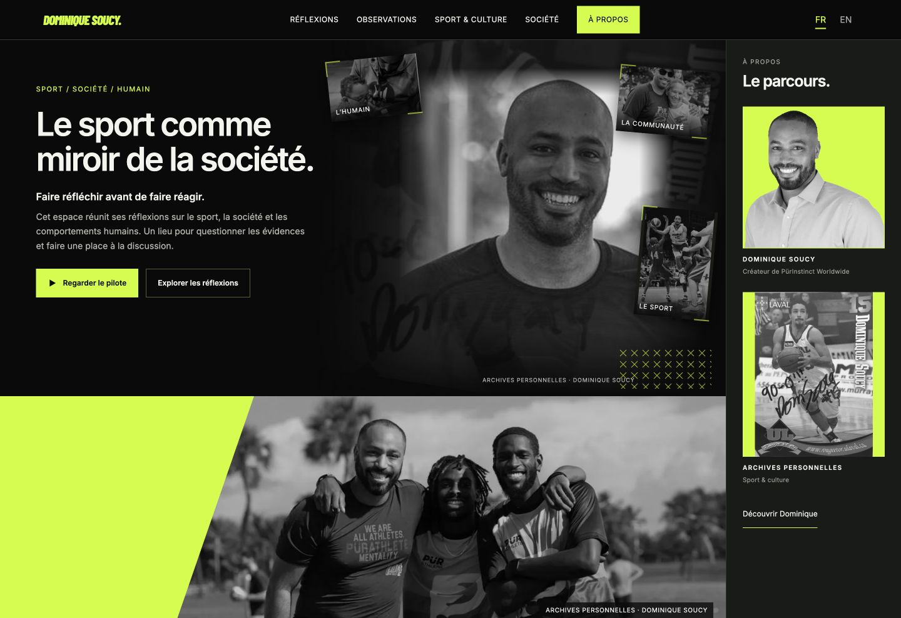
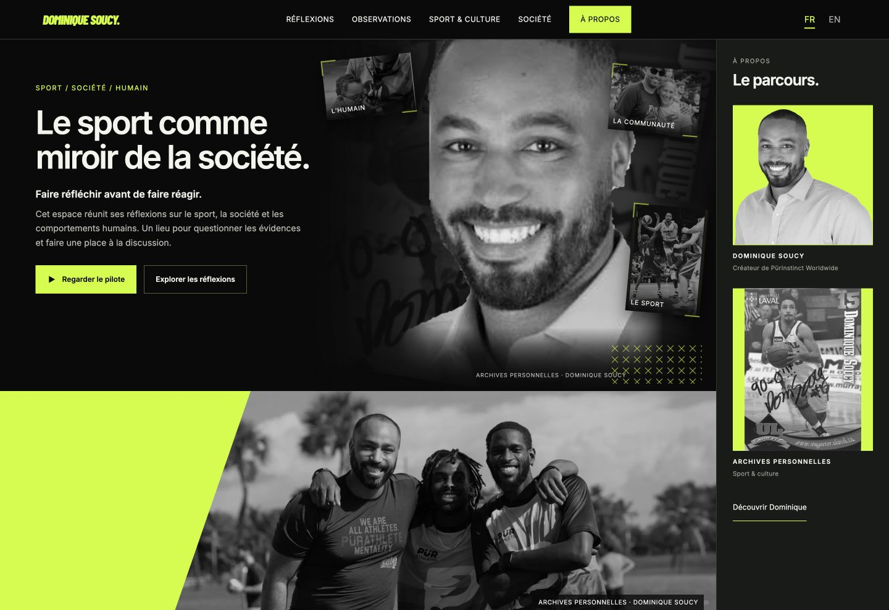
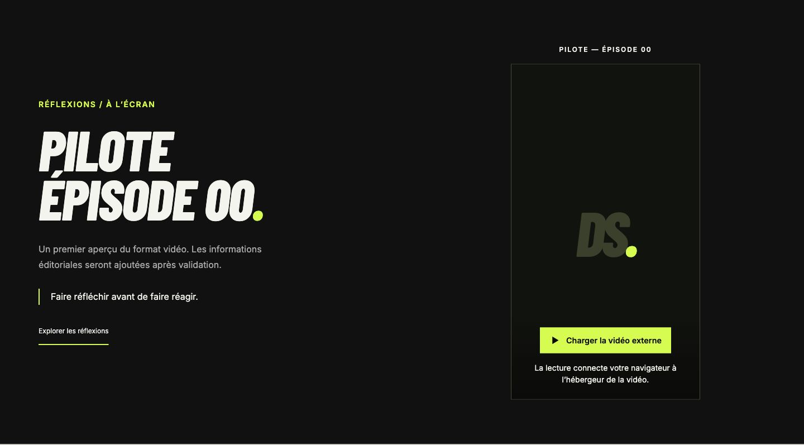
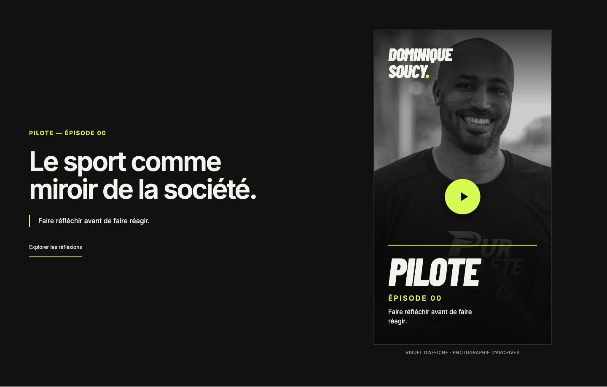
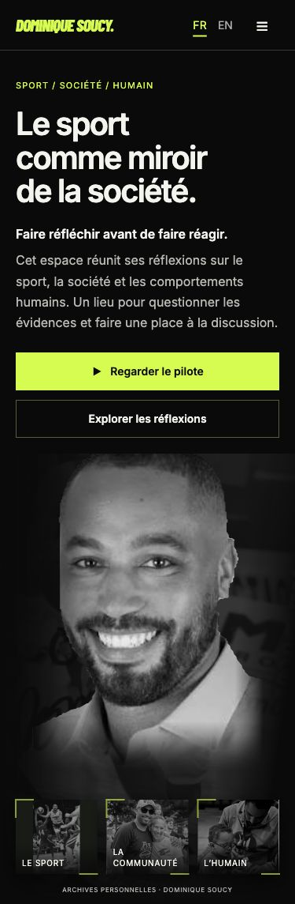
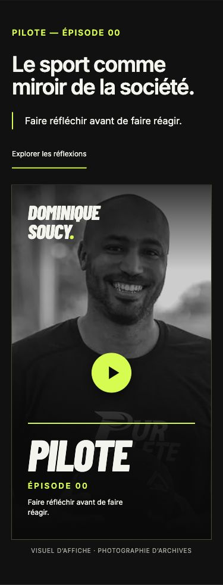
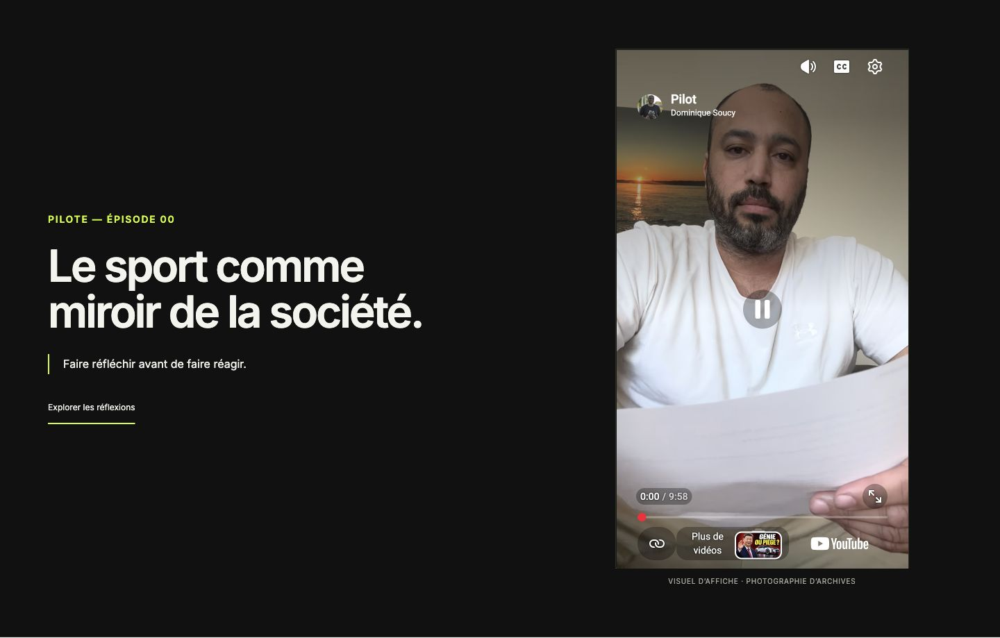

# V6.3 — Extreme close-up and cinematic pilot poster

## Inspection and scope

Started from `main` at `8f1f71a`, after confirming PR #7 was merged. Read the hero/collage, shared player, adaptive geometry, photography manifest, homepage, current pilot copy and styles before changing them. PR #7's thumbnail component, configuration, styles and homepage placement are preserved unchanged. The sidebar and editorial sections remain intact.

The previous portrait was a whole square photo at scale 1.65, constrained to a 720px full-image width. Enlarging the surrounding container could not make its face sufficiently large. The new framing changes the actual source, zoom, transform origin, excluded source pixels and edge masks.

## Authentic media and limitations

- **Hero**: `public/assets/dominique/originals/02_portrait_chemise_bleue.jpg`, 447×447. Its face occupies more of the original than the previous ball portrait. Scale 2.1, a 900px full-image ceiling and horizontal focus at 24% bring both eyes, smile, beard and chin into the center-right close-up. Forehead/shoulders may extend beyond the frame; the lower 28% of the source is excluded. There is no ball in this original. The existing authentic-source silhouette mask is reused, with soft CSS edge fades. No facial RGB pixels, anatomy, smile or eyes are edited.
- **Temporary poster**: `public/assets/dominique/originals/05_portrait_ballon.jpg`, 512×512. No approved original pilot poster or white-shirt video still was found in the repository. This authorized archive photo is therefore used as temporary artwork, explicitly credited as poster artwork rather than a frame from the pilot. It is not a screenshot of the AI concept. No video still, stock scene or facial detail was fabricated.
- The other six originals, archive layers, satellite photos and historical sidebar postcard remain unchanged. Existing SHA256/package integrity tests pass for all originals.

The hero's original remains small: a 900px full-image rendering is about 2× its native width. The extreme close-up is visibly more intimate but softer on large/high-density displays; natural compression and cutout imperfections remain. A future high-resolution approved portrait will improve sharpness. There is no generative upscaling or synthetic detail to hide that limit.

The previous supplied visual reference is used only for composition. The before-pilot screenshots were captured from the current public V6.2 site. Before-hero images are archived settled browser captures of V6.1; the hero source and styling were unchanged in V6.2, as verified against main. This avoids using intermediate entrance-animation frames as an unfair baseline. Comparisons show real website captures, not an AI mockup presented as implementation.

## Central configuration

`lib/homepage-media.ts` centralizes both hero and pilot poster source, crop, localized alt/overlay text, play label, provider notice, image positioning, visibility and click-to-play policy. `lib/hero-media.ts` retains compatibility exports. The pilot URL still comes from the single existing `pilotVideo` configuration in `lib/config.ts`, so the poster and three discovery cards cannot drift onto different pilot URLs.

Future replacement requires configuration updates, not rebuilding the components. The temporary poster can become a true approved video frame by replacing its path, positioning, alt text and credit here.

## Player and layout

`CinematicVideoPoster` is a real accessible button inside the existing `AdaptiveVideo` frame. It renders a locally hosted authentic photo, charcoal gradients, restrained grain, Dominique's name, localized pilot/episode text and a 64–86px lime play control. The play control sits below the face, with 400ms hover/focus transitions and no bounce or glow. The consent/provider notice is available to screen readers rather than displayed as unfinished technical copy.

No iframe, YouTube image, preconnect or video request is created by the poster before activation. Enter, mouse or touch activation replaces it with the existing privacy-enhanced YouTube iframe in exactly the same reserved 9:16 area and transfers focus. `autoplay=1`, `playsinline=1` and `controls=1` are added only after activation, with the autoplay permission then granted to that iframe. Native YouTube controls remain usable if browser policy blocks autoplay. Actual pilot playback was observed in the browser after one keyboard activation; the video was also tested with mouse activation in EN. Legacy non-cinematic players retain their previous no-autoplay behavior; the complete orientation/layout suite still passes. Optional local-file playback also focuses its native control after activation.

The pilot copy uses only the existing approved positioning and mission translations. Unfinished publication language and the duplicated episode heading are removed. Desktop uses a balanced two-column composition with a prominent vertical poster; mobile stacks the approved text and poster. The frame and its dimensions remain identical before/after activation, preventing media layout shift.

The hero's small desktop parallax is retained, without facial distortion. Its entrance now starts at 85% opacity so the face is visible immediately. Mobile has a dedicated close-up with the three satellites in their separate row, away from eyes and smile. Reduced motion disables movement/transitions while preserving the crop.

## Executed validation

- `npm run content:check`: passes (zero published editorial entries, as before).
- `npm test`: **43 tests pass**, including all legacy adaptive-video orientations/layouts, original-photo integrity, hero source/crop configuration, reusable poster configuration and activation-only playback URLs.
- `npm run lint`, `npm run typecheck`, `npm run build`, formatting and diff checks: pass.
- Real compiled screenshots at **375, 430, 768, 1440, 1920px** cover the hero, complete pilot section, isolated poster, player after activation and all three thumbnail styles. Hero/pilot views were visually inspected at all five widths. FR and EN text/play labels were checked; EN mouse activation and FR keyboard activation work.
- Measured zero horizontal overflow at each width; one player, three thumbnail styles, no initial iframe; poster and iframe preserve ratio 0.5625 and exactly the same frame width/height after activation. Focus moves to the iframe.
- The host reduced-motion setting was not changed; the existing media-query behavior and new poster rules were inspected in code. The browser's restricted inspection scope does not expose the Performance API, so no claim of a measured network waterfall or LCP score is made. DOM checks and code inspection confirm no pre-activation iframe or YouTube resource hint.

No production merge/deploy. Branch `codex/homepage-v6-3-closeup-poster` is for review; the Vercel Git preview is recorded in the PR and Codex delivery.

## Before / after (actual website)

| Before V6.2                                   | After V6.3                                |
| --------------------------------------------- | ----------------------------------------- |
|    |     |
|  |  |

## Mobile and live player proof

All five resolution sets, including all three preserved card styles, are in `review/`; `checks.json` records the frame measurements before/after activation.
