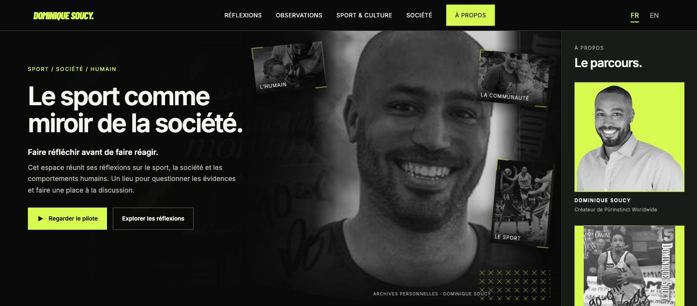
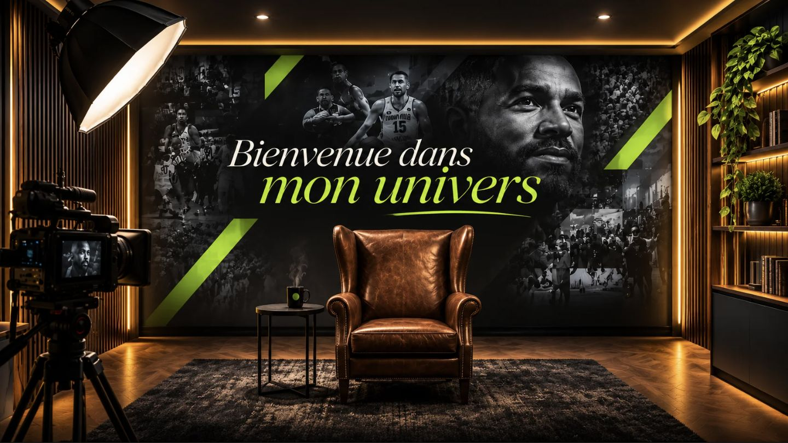

# V6.4 — The human, the universe, the pilot

Restores the authentic `05_portrait_ballon.jpg` close-up, retaining the small `02` sidebar portrait. Includes the existing PR #9 correction rather than replacing it. Originals remain unchanged; no facial generation or retouching was performed. The 512px source limits fine detail in the enlarged hero.

The exact supplied studio artwork is stored at `public/assets/studio/studio-universe.png` (1672 × 941). SHA-256: `494086538de7ff46be1941b29da7f7b5ab7e7eba8cc70c0d2ea050b09dfda69e`. The manifest records its provenance. This is supplied artistic imagery, not a claim that the scene documents a physical studio. `hero-reference.png` is a design reference only and is never rendered by the application.

As requested, the studio first appears behind the hero at 9% opacity with additional black gradients and desaturation, then appears fully in a dedicated section before the three pilot cards. Both uses share the same optimized image URL. Central configuration lives in `lib/homepage-media.ts`.

`StudioUniverseSection` retains the complete image ratio on desktop and mobile. French lettering is already embedded in the source, so no duplicate slogan is overlaid. English preserves that unedited artwork and adds “Welcome to my world” below it. The optional motion wrapper uses a 900ms reveal and at most 6px desktop parallax; reduced-motion users receive a static presentation. Images load lazily, and aspect ratios reserve space before loading. Next Image quality 85 is explicitly allowed.

## Verification

- 46 automated tests passed, including exact artwork integrity, hero source/crop, locale presentation, and subtle background reuse.
- Content validation, lint, TypeScript, and production build passed.
- FR and EN inspected at 375, 430, 768, 1440, and 1920px. `review/checks.json` records all ten cases: no horizontal overflow, correct portrait source, complete studio aspect ratio, three cards, expected section order, and shared optimized studio URL.
- All three French pilot cards focus the existing player without creating an iframe. Explicit playback replaces the poster, focuses the iframe, and uses the existing YouTube privacy-enhanced embed. Responsive checks also confirm the portrait player/poster remains intact in both locales.
- Reduced-motion behavior was checked in implementation; no operating-system accessibility settings were changed.

## Captures

[375px French hero](review/375-fr-hero.jpg) · [375px French studio](review/375-fr-studio.jpg) · [430px English studio](review/430-en-studio.jpg) · [768px studio](review/768-fr-studio.jpg) · [1920px English studio](review/1920-en-studio.jpg)

No merge or production deployment is part of this change.
