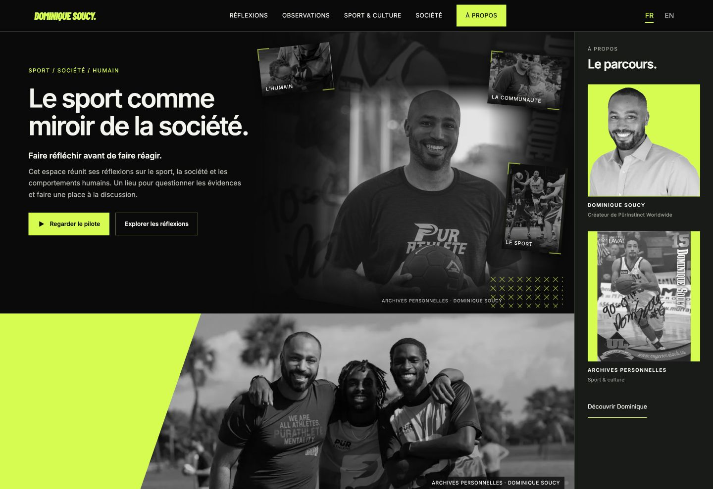
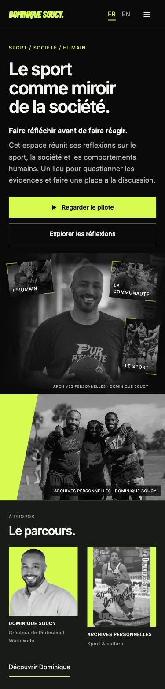

# V6 — Cinematic homepage implementation

## Approved package

Source: `dominiquesoucy_homepage_cinematic_assets.zip` on `main` at `c0eca98`.
Read the package README, manifest and `docs/CINEMATIC_HOMEPAGE_SPEC.md` before implementation. The approved composition is `design/references/homepage-cinematic-approved-concept.png` within this directory; the previous concept is comparison material only. Neither image is served from `public` or referenced by the application.

All 21 supplied original/vintage/provisional-transparent files were compared byte-for-byte with existing repository files. They already matched, so no duplicates or replacements were written. The seven monochrome WebP archives, film-grain PNG and manifest were extracted to `public/assets/home-cinematic/` without alteration. The original ZIP remains available.

## Composition and authentic layers

The existing navigation, hero wording, pilot/reflections actions, right biography column, basketball archive card and lower PürAthlete photograph remain intact. `CinematicCollage` adds the following independent layers inside `CinematicHero`:

- Near-black backdrop, soft CSS gradients and the supplied grain texture.
- Low-opacity supplied `07_archive_rouge_et_or-bw.webp` basketball archive.
- Authentic original `05_portrait_ballon.jpg`, displayed at up to 440px against its 512px source. CSS grayscale and edge gradients retain the original photographic pixels and facial features. This existing modern portrait avoids enlarging the 447px blue-shirt source into the oversized AI-rendered face in the concept.
- Supplied monochrome images 01, 03 and 06 as selectable sport, community and human-connection tiles, with localized captions and lime corners.
- Personal-archive credit, without invented documentary scenes, episode durations or a simulated video timeline.

The blue-shirt sidebar image and its previously cleaned alpha mask are unchanged. Provisional package cutouts are not used. No face generation, photographic raster edits, additional packages or external media requests were introduced.

## Interaction and accessibility

The calm interaction option in the specification is implemented: one desktop fade-in, pointer parallax capped at 8px per axis, and photo emphasis on hover, keyboard focus or activation. Native toggle buttons expose `aria-pressed`, can be selected with touch/Enter/Space, and toggle off on repeated activation. Only one selection is retained. There is no perpetual montage, flashing or autoplay audio/video.

Pointer movement updates CSS variables in a cancellable animation frame rather than rerendering React. Event listeners and pending frames are cleaned up. Pointer parallax is enabled only on desktop with a fine pointer, hover support and no reduced-motion preference. Changing that preference resets offsets. Reduced-motion CSS removes animation, transitions and transforms; mobile remains a static composition with optional photo emphasis.

Headings and primary actions precede archive controls in DOM order. The collage follows the text on mobile/tablet, reserves its height before media loads, and clips decorative layers so they do not cover actions. Images have intrinsic dimensions; secondary archives use lazy loading. The real portrait is eager and served without a second lossy compression pass. The existing secure adaptive player remains user initiated.

## Verification

- 36 automated tests passed: existing 35 plus package integrity for originals, monochrome archives and texture, and confirmation that reference mockups stay outside public assets.
- Lint, TypeScript, editorial validation, production build, formatting and diff checks.
- FR/EN browser inspection at 375, 768, 1440 and 1920px: no horizontal overflow, correct localized links, three archive controls, no external iframe before consent; portrait remains below source width.
- Touch/click selects an archive; Space toggles it off. Mobile composition stays below the actions. Production-build screenshots accompany the PR in the Codex conversation.

Vercel Git deployment is explicitly disabled for `codex/homepage-v6-cinematic`. Review only: do not merge or deploy automatically.

## Review captures

Desktop, 1440px:

Mobile, 375px:

