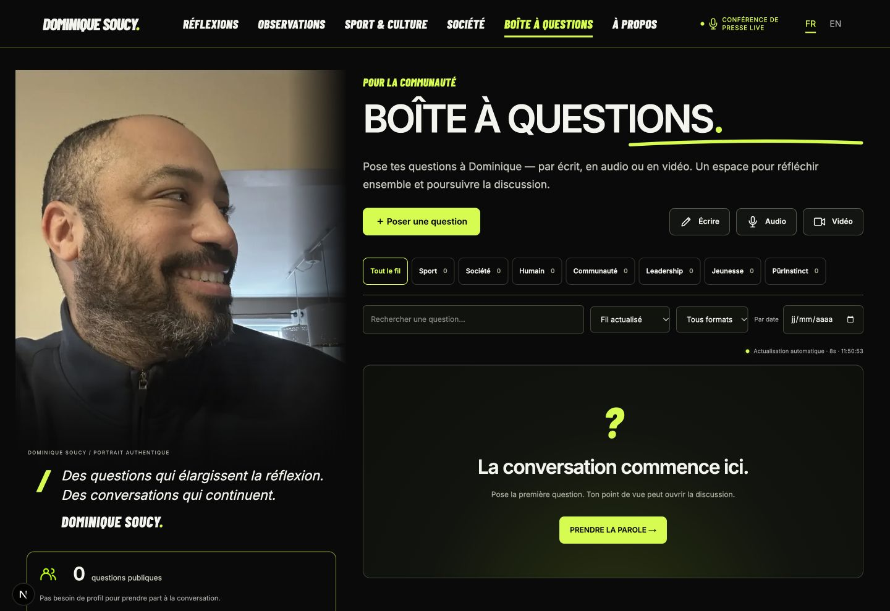

# V7.1 — Boîte à questions

Application publique `/fr/questions` et `/en/questions`, fil par contribution `/[lang]/questions/[id]`, régie privée `/[lang]/studio-live/questions`. L’accueil et la conférence de presse sont conservés; la régie réutilise leur authentification serveur.

## Architecture

`lib/questions/db.ts` initialise des tables SQL persistantes avec libSQL/Turso. Sans configuration, le développement utilise un véritable fichier SQLite `.data/questions.db`, pas un tableau de démonstration. Vercel/production exigent une base distante et refusent le repli sur un disque éphémère. Aucun faux utilisateur ni question n’est inséré.

Tables : catégories, questions, médias, réponses, réactions uniques, signalements privés, curation/notes privées, émissions/ordre de passage, compteurs expirants, réglages d’urgence. Les sessions administrateur restent dans le stockage Redis du studio existant. `repository.ts` expose un DTO public explicite : pas de notes, consentements de réutilisation, signalements, empreintes techniques ou clés de stockage.

Le fil s’actualise toutes les huit secondes lorsque la page est visible, ainsi qu’au retour sur l’onglet. L’indication d’actualisation n’apparaît qu’après une réponse réussie. Une panne affiche une erreur; elle n’est pas présentée comme un fil vide. Recherche littérale paramétrée, catégories réelles, filtres format/date, classement et pagination sont disponibles.

Les fichiers restent hors SQL : répertoire privé `.data/media` en développement et Vercel Blob **privé** sur Vercel. Une route contrôlée sert uniquement les médias de questions visibles, avec plages HTTP pour les lecteurs natifs. Masquer une question retire aussi son accès média public et sa sélection de présentation. Les proportions vidéo proviennent des dimensions du média.

## Installation et configuration

`npm ci`, compléter `.env.local`, puis `npm run dev -- --port 3103`. Ouvrir `http://localhost:3103/fr/questions`.

- `QUESTIONS_DATABASE_URL` et `QUESTIONS_DATABASE_AUTH_TOKEN` : base libSQL distante, par exemple Turso; aucun service payant n’a été créé. Les tables sont initialisées automatiquement de façon idempotente.
- `QUESTIONS_PRIVACY_SECRET` : secret aléatoire serveur pour les empreintes HMAC. En développement, un fichier privé local est généré. Ne jamais utiliser une valeur `NEXT_PUBLIC_` ni perdre ce secret sans prévoir l’impact sur la reconnaissance des contributions.
- `BLOB_READ_WRITE_TOKEN` : store Vercel Blob privé, distinct si possible entre production et prévisualisation.
- `QUESTIONS_MEDIA_SCAN_URL` / `QUESTIONS_MEDIA_SCAN_TOKEN` : service HTTPS de contrôle automatique des contenus, recevant les octets audio/vidéo avec Authorization Bearer et renvoyant `{ "allowed": true }` uniquement si admissibles. Sans ce service, les médias sont refusés en environnement déployé. L’examen n’est pas une file d’approbation humaine. En local, seuls les contrôles techniques sont exécutés et cette limite est affichée.
- `NEXT_PUBLIC_QUESTIONS_TURNSTILE_KEY` / `QUESTIONS_TURNSTILE_SECRET` : protection Cloudflare Turnstile facultative. Renseigner les deux ensemble. Sans ces clés, le honeypot, la preuve de formulaire temporisée et les limites SQL restent actifs; ils ne remplacent pas une authentification forte ou une protection anti-bot spécialisée.
- `STUDIO_ACCESS_CODE`, `STUDIO_REDIS_URL`, `STUDIO_REDIS_TOKEN` : reprendre la configuration privée V7. Aucun code réel n’est inscrit ici. Pour le serveur HTTP de boucle locale uniquement, `STUDIO_LOCAL_HTTP=true` permet les cookies en développement; l’exception est ignorée en production.

Sans base distante, la prévisualisation Vercel affiche son état de configuration manquante. Elle ne prétend pas offrir une persistance sur son disque local. Les essais fonctionnels décrits ci-dessous ont utilisé la base et le stockage locaux réels.

## Publication et sécurité

Les contributions admissibles sont visibles immédiatement, sans statut d’approbation. Consentement public obligatoire; autorisation de réutilisation de la voix/image indépendante et facultative. Le mode présentation ne charge pas ces médias si cette autorisation manque.

Cinq questions par source sur une heure, dix réponses par quinze minutes, compteurs atomiques SQL; limites additionnelles pour réactions et signalements. La réaction est unique par visiteur et par empreinte de source pour limiter les multicookies; plusieurs visiteurs sur un même réseau peuvent donc partager cette limite. Pas de coordonnées demandées; contrôles élémentaires sur liens, coordonnées et menaces. Ces contrôles ne garantissent pas la détection de tout contenu illégal. Les signalements restent privés et la régie peut masquer, retirer et suspendre le fil ou les publications.

Les médias sont limités à 3 Mo, 60 secondes audio et 30 secondes vidéo par défaut. Ces valeurs sont configurables dans les plafonds prévus; le plafond de 3 Mo tient compte du trajet serveur V1 et des limites de requête Vercel. Le navigateur enregistre à débit modéré; il est possible de choisir un fichier compatible. FFprobe vérifie réellement les flux, la durée et les dimensions; une extension ou un MIME déclaré ne suffit pas. Les formats exécutables, SVG, playlists et fichiers forgés sont refusés. Un service de sécurité des contenus est exigé pour les médias déployés.

Le navigateur n’active les périphériques qu’après action explicite. La demande d’autorisation expire après quinze secondes; tout flux accordé après expiration ou fermeture est arrêté. Refus, absence de périphérique, interruption, taille et durée excessives disposent d’états d’erreur.

## Vie privée, conservation et suppression

Questions, pseudonymes, réponses et médias restent publics jusqu’à retrait. Les visiteurs sont reconnus par un cookie HttpOnly/SameSite, Secure en déploiement, valable six mois. Les adresses réseau brutes ne sont pas stockées; des empreintes HMAC privées servent à l’anti-spam. Les contenus déjà téléchargés hors du site ne peuvent pas être rappelés par l’application.

Le navigateur d’origine permet de supprimer sa question; la régie peut aussi traiter une demande reçue par signalement. La suppression retire les réponses, réactions, signalements, curation et média. Si le stockage échoue, la question reste masquée et l’opération peut être retentée. Les notes de régie ne sont jamais rendues dans la présentation OBS.

Politique de maintenance recommandée : purger les compteurs expirés quotidiennement, les signalements traités après 90 jours selon les besoins, et contrôler les objets orphelins après échec de téléversement. Aucun effacement périodique ni coût de service n’a été activé automatiquement. Les publications sont permanentes par conception jusqu’à retrait; prévoir sauvegardes et procédure de restauration côté base/store avant un lancement communautaire.

## Régie et OBS

Sélectionner, annoter, marquer À traiter / Sélectionnée / Utilisée / Archivée, puis enregistrer une émission. L’ordre accepte le glisser-déposer et des flèches natives accessibles au clavier. Les révisions empêchent un ancien onglet d’écraser silencieusement une sélection plus récente. La présentation utilise l’ordre enregistré, une question à la fois, avec précédent/suivant et commandes masquables.

OBS peut ouvrir l’URL privée comme source navigateur. Utiliser Interagir pour se connecter puis lancer la présentation; son profil ne partage pas la session du navigateur habituel. Ne pas inclure le code dans l’URL. L’application ne contrôle pas OBS.

## Validation et limites des essais

`npm test`, `npm run lint`, `npm run typecheck`, `npm run format:check`, `npm run build`.

`node --env-file=.env.local scripts/check-questions.mjs` exécute uniquement contre un serveur local : refus privés sans session, uploads WAV/MP4 synthétiques, lecture identique et HTTP Range, réponse, réaction, signalement, notes privées, sélection et masquage. Ce scénario laisse des contributions explicitement marquées validation locale pour examen au navigateur; elles ne sont jamais importées en production.

Les fixtures de `tests/fixtures/questions` sont un son synthétique et une vidéo noire avec son synthétique. Aucun visage, enregistrement personnel, faux membre ou faux compteur n’est utilisé. Les tests unitaires couvrent SQL persistant, filtres, confidentialité, ordre transactionnel, suppression en cascade, anti-spam, consentement, validation réelle des fichiers et gestion simulée des permissions/tardives.

Au navigateur : question texte réellement publiée, réponse et réaction persistantes, upload audio avec aperçu d’une seconde. L’autorisation matérielle du microphone n’a pas abouti dans le navigateur d’essai; la captation micro/caméra réelle et les appareils iPhone/Android restent à valider. Les tests de fichiers ne sont pas présentés comme des tests de captation matérielle. Les services cloud Turso, Blob et scanner ne sont pas encore configurés/testés ici.

Captures de composition et des états vides : `design/questions-v7-1/review/`. La photographie et les recadrages proviennent exactement du ZIP fourni; `public/assets/questions/manifest.json` en consigne les empreintes. La maquette est une référence dans `design/`, jamais une image d’interface servie au public.

## Résultat de livraison V7.1

78 tests automatisés réussis; lint, typecheck, formatage, vérification du diff et build de production validés. Le scénario HTTP a passé 25 vérifications. La régie a été ouverte après authentification : ordre changé au clavier, émission enregistrée, vidéo autorisée présente en présentation, audio sans autorisation exclu et notes privées absentes de cette vue. Le fil anglais relit les quatre contributions de validation depuis la même base; elles restent uniquement locales.

[Mobile FR](../../design/questions-v7-1/review/375-fr-empty.png) · [Mobile EN avec données de validation](../../design/questions-v7-1/review/375-en-feed.png) · [Régie privée](../../design/questions-v7-1/review/1440-fr-private-console.png) · [Présentation et consentement](../../design/questions-v7-1/review/1440-fr-presentation-consent.png)
